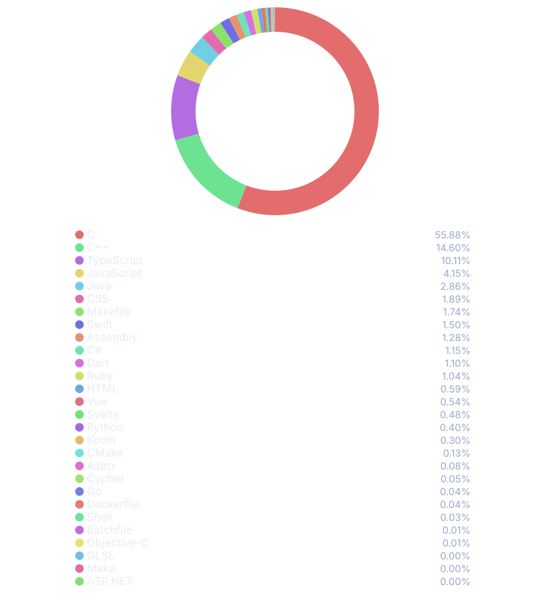

<h1 align="center">Hey, I'm Martin 👋</h1>

  

  
  
  

I enjoy building software, exploring new technologies, and understanding how things work under the hood. I'm always curious about new ideas and like turning what I learn into practical projects.

Some things I'm particularly interested in:

 <strong>Backend & Full-Stack Development</strong> - building APIs, services, and applications.

 <strong>Software Architecture</strong> - system design, clean code, and distributed systems.

 <strong>Artificial Intelligence</strong> - experimenting with LLMs, RAG, and AI agents.

 <strong>Technology Exploration</strong> - trying new frameworks, tools, and development workflows.

 <strong>Problem Solving</strong> - tackling programming challenges and improving through practice.

<h2 align="center">
  
  Skills & Tools
</h2>

  <h3>Backend & APIs</h3>
  
  <h3>Frontend</h3>
  
  <h3>Databases & Build Tools</h3>
  
  <h3>DevOps & Developer Tools</h3>
  
  <h3>Other Languages & Frameworks</h3>
  

 

<!-- 

  

 -->

---

  <i>Building, experimenting, and learning along the way.</i>

